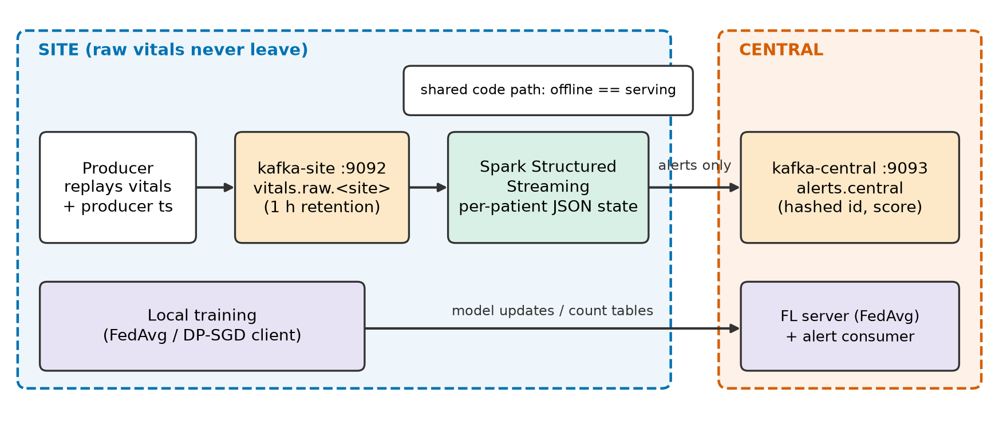

# Privacy-Preserving Patient Vitals Monitoring — a Kafka + Spark Streaming study

Stream patient vitals (heart rate, SpO2, respiratory rate, systolic BP, temperature), flag anomalies
instantly with **per-patient adaptive thresholds**, and test whether the system can **match baseline
accuracy while raw data stays local** (federated learning and record-level differential privacy).

## Quick start

```bash
make venv          # Python 3.11 venv (.venv) with core + Spark requirements
make test          # unit tests (pytest)
make data          # download the open eICU-CRD demo (PhysioNet, no credentials)
make up            # two Kafka (KRaft) clusters + topics via Docker Compose
make experiments   # full study on BOTH datasets (5 seeds, ablations) + benchmarks -> results/summary.json
make figures       # all figures -> figures/ and docs/architecture.png
make docs          # report (.docx/.pdf) and deck (.pptx), generated from results/summary.json
make dist          # dist/code.zip, dist/report.zip, dist/ppt.zip
```

## Architecture



* `kafka-site` (`:9092`) holds raw vitals in `vitals.raw.<site>` with 1 h retention.
* `kafka-central` (`:9093`) receives **alerts only**: salted-hash patient id, site, timestamp, score, model tag.
* The Spark Structured Streaming job (`src/pvm/stream/spark_job.py`) keeps per-patient state with
  `applyInPandasWithState` (state serialised as JSON) and scores each event with the same code
  used offline (`src/pvm/features.py`, `src/pvm/serving.py`).
* A consumer on the central cluster measures end-to-end latency (p50/p95/p99).

## Methods compared (held-out = last 40 % of every patient's series)

| | Method |
|---|---|
| A / A2 | static ward thresholds (instant / persistence m = 3) |
| B | centralised ML, features normalised with fixed population priors |
| C | per-patient adaptive threshold, no learning |
| D | centralised ML on adaptive features |
| E | local-only training per site |
| F | **federated (FedAvg)** on adaptive features |
| G | F + differential privacy (per-record clipping, Gaussian noise, Rényi accountant, δ = 1e-5; **record-level** ε) |

## Data and honesty

* **Public dataset:** eICU-CRD demo `vitalPeriodic` (5-minute sampling). See `data/README.md`.
* The public data has **no ground-truth anomaly labels**, so the study uses a **semi-synthetic protocol**:
  real physiology + injected, labelled deterioration episodes (no episode crosses the train/test split).
* A **synthetic cohort generator** (6 phenotypes, non-IID sites, AR(1) noise, circadian drift, artefacts) is also provided.
* Every table and figure is labelled with its dataset; synthetic results are never reported as public-dataset results.

## Running the streaming pipeline by hand

```bash
make up                                                     # Kafka x2 + topics
PYTHONPATH=src .venv/bin/python -m pvm.train                # exports models/model.json
export JAVA_HOME=$(brew --prefix openjdk@17)                # Java 17
export PYSPARK_PYTHON=$PWD/.venv-spark/bin/python PYTHONPATH=src
.venv-spark/bin/python -m pvm.stream.spark_job --trigger "1 second" &   # add --emit-all to alert on every event
.venv-spark/bin/python -m pvm.stream.consumer --idle 30 &               # latency percentiles
.venv-spark/bin/python -m pvm.stream.producer --rate 500 --events 20000
.venv-spark/bin/python -m pvm.stream.bench_kafka            # full latency/throughput sweep
```

The Spark venv needs pandas 2.2.x (PySpark 3.5 `applyInPandasWithState` breaks with pandas 3) and the
Kafka clients must use `127.0.0.1`, not `localhost`.

## Layout

```
src/pvm/            features, serving, models, federated, privacy, metrics, methods, experiments, summary, figures, docs
src/pvm/stream/     producer, consumer, spark_job, bench_kafka
tests/              pytest (adaptive state, metrics, DP accountant, split, FedAvg, serving == offline, loader)
docker-compose.yml  two KRaft Kafka clusters
results/summary.json   the single source of every number in the report and deck
```
